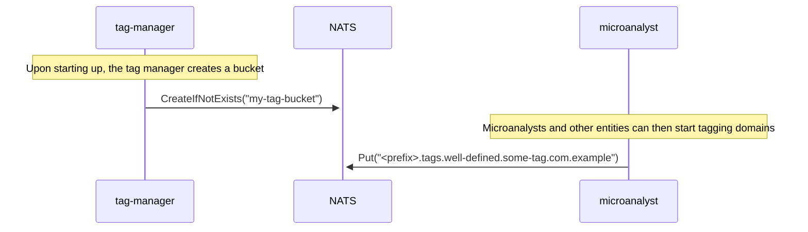
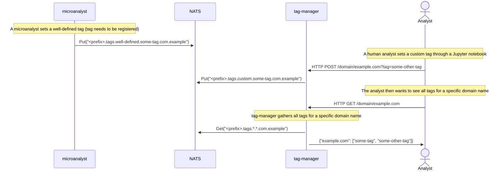

# Overview
The `tag-manager` is responsible for tagging domains in NATS. It uses
the NATS Key-Value (KV) store functionality to do so. Upon starting up
it must make sure there is a bucket provisioned in the NATS cluster for
storing the tags.

Microanalysts who rely on `tapir-analyse-lib` can set tags directly with
the lib and do not need to go via `tag-manager`. Microanalysts should
not try to set up the tag bucket themselves, however.

`tag-manager` should provide a REST API so that tags can be set
programmatically through that, for instance from a Jupyter notebook.
Setting tags via the REST API should require authorization.

`tag-manager` should also provide a web GUI for browsing the tagged
domains. Searching and filtering based on tags and/or domain name
should be possible. It should also be possible to set tags via the web
GUI, after authorization.

There are two classes of tags, `well-defined` and `custom`.
`well-defined` tags are those that have received a code point
[here](https://github.com/dnstapir/tapir-analyse-lib/blob/main/common/tags.go).
`custom` tags are those that have not. Both kinds should be settable from
the web GUI and via the REST API. `tag-manager` is responsible for placing
them in the correct namespace, either `<prefix>.tags.well-defined` or
`<prefix>.tags.custom`.

A domain, `example.com` is tagged with `some-tag` if there exists a key
`<prefix>.tags.well-defined.some-tag.com.example` in the tag bucket.
Alternatively, for a `custom` tag the key would be something like:
`<prefix>.tags.custom.some-other-tag.com.example`.
The value behind the key can be anything, it is currently unused. The
`<prefix>` placeholder is a configuration parameter that the Core
operator can choose as they please to avoid namespace collisions with
other things that might be using the same NATS cluster.

# Example 1: Starting up

# Example 2: Reading and writing

